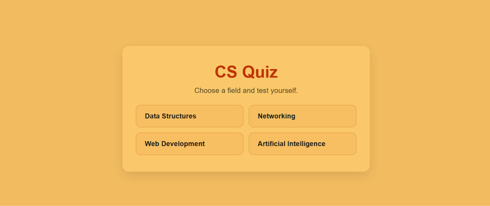

# CS Field Quiz

An interactive quiz where students choose a computer science field and test themselves with instant feedback and a live score.

<!-- Live demo: add the link after enabling GitHub Pages -->
<!-- [Try the live demo](https://imad2612.github.io/css-field-quiz/) -->



## Why I Built It

Most beginner quizzes ask the same questions in one list. I wanted students to choose the topic they need to practice, see their progress for that field, and try again without restarting the whole app. This project was also a chance to practice organizing data, building UI from JavaScript, and managing screen flow with plain code.

## Features

- Choose from four fields: Data Structures, Networking, Web Development, and Artificial Intelligence
- Five multiple-choice questions per field
- Instant feedback: the correct answer turns green and wrong answers turn red
- Live score and progress bar
- A result message based on your score
- "Choose another field" to switch topics at any time

## Getting Started

No installation or build step is needed.

1. Clone or download this repository.
2. Open `index.html` in your browser.

For the best experience, run it through a local server such as VS Code's Live Server extension.

## Project Structure

```
css-field-quiz/
├── index.html   # Screens and page structure
├── style.css    # Layout, colors, and responsive styles
├── script.js    # Question data, field picker, and quiz logic
└── README.md    # This file
```

## How It Works

All questions live in the `quizData` object in `script.js`. Each key is a field name, and each value is an array of questions. The start screen builds one button per field from those keys, so adding a new field only means adding a new entry to `quizData`.

## Adding a New Field

1. Add a new key and question array to `quizData` in `script.js`.
2. Save the file. The new field button appears automatically.

## Built With

- HTML5
- CSS3 (custom properties, Grid, responsive media queries)
- Vanilla JavaScript (DOM manipulation and event handling)

## Possible Improvements

- Show a short explanation after each answer
- Remember the best score for each field with `localStorage`
- Add keyboard shortcuts for answering

## Author

Imad BOUKICH